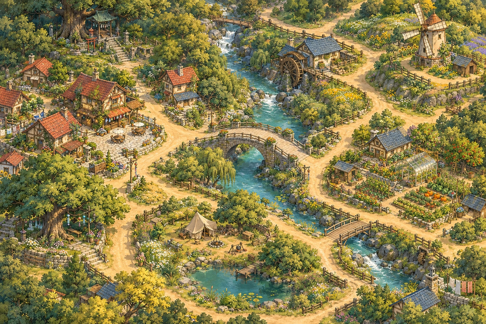

# 风铃溪谷 / Windbell Valley

一座可以慢慢散步的温暖手绘村庄。沿溪行走，拜访邻居，收藏七段溪谷时光。



## 在线体验

[进入风铃溪谷](https://ltl961209-rgb.github.io/windbell-valley/)

## 漫游

- 点击小路或地点列表：沿道路自动行走。
- WASD / 方向键：手动行走；溪水与房屋不可穿越。
- 拖动：移动镜头。滚轮、双指或 ＋ / −：缩放。
- 走近并点击居民：与阿禾爷爷、小满、栗子猫对话。
- 白昼 / 日暮：切换氛围。相机：保存当前画面为明信片。
- 点击“听见溪谷”播放音乐；指南内可调音量。
- 七处地点的手记保存在本设备的 localStorage，无账号、无服务器。

## 本地运行

不需要安装前端依赖，也没有构建步骤。在此目录执行：

```sh
python -m http.server 18845 --bind 127.0.0.1
```

然后打开 `http://127.0.0.1:18845/`。请通过 HTTP 服务访问，直接双击 HTML 的 `file://` 模式不能加载 JavaScript 模块及音乐。

## 场景与素材

- 世界坐标：3072 × 2048；手绘底图：1536 × 1024。
- 七个地点：风铃茶屋、古树神社、听溪石桥、山坡磨坊、花间温室、溪畔营地、风铃古树。
- 96 个道路节点、99 条路段；最短路径寻路与道路范围碰撞。
- 主角风禾、阿禾爷爷、小满、栗子猫：每个角色 4 张透明步行动画帧，脚底锚定、按脚底 Y 排序、独立行动路径。
- 溪水光斑、炊烟、飘叶、蝴蝶、飞鸟、日暮萤火与窗灯独立实时合成。
- 原创合成配乐《午后的来信》：96 秒循环、75 BPM、3/4 拍，钢琴、拨弦、铺底、风铃与轻环境声。44.1 kHz 双声道 MP3。

| 文件 | 用途 |
| --- | --- |
| `index.html` / `style.css` | 响应式网页与界面 |
| `app.js` | 手记、对话、音频、明信片 |
| `scene.js` | 道路、镜头、角色与环境动画 |
| `assets/valley.webp` | 手绘村庄底图 |
| `assets/characters.png` | 生成的透明角色原图 |
| `assets/actors/*-0.webp` 至 `*-3.webp` | 对齐后的角色动画帧 |
| `assets/actors/*-walk.webp` | 四个角色的独立透明循环动画 |
| `assets/animation.json` | 动画帧尺寸、路径及锚点说明 |
| `assets/audio/windbell-valley.mp3` | 完整配乐 |

## 参考与原创内容

场景组织参考 [aldegad/sprite-gen 的 village-scene.gif](https://github.com/aldegad/sprite-gen/blob/main/docs/assets/village-scene.gif) 与 [scene 协议](https://github.com/aldegad/sprite-gen/blob/main/docs/scene.md)：独立角色循环、统一脚底锚点、背景与活动层分离。新作扩展为可探索的斜俯视村庄。未复制参考项目的画面、人物或音乐，未调用其付费视频生成服务。

地图和角色为本项目使用图像生成工具新生成；动画经过透明切片、对齐和网页运行时制作。配乐为本项目以合成音色编排的原创音乐，不是录制的真人乐队。

## 验证与发布

实际 Chrome 检查 1440 × 900 和 390 × 844：页面无横向溢出；地点导航、NPC 对话、键盘碰撞、触摸/鼠标拖拽、缩放、暂停、昼暮、音乐开关、音量、手记持久化、明信片下载通过。7 个地点均可到达；49 组地点组合路由连通。验证不等同于所有移动设备的兼容性测试。

GitHub Pages 使用 `main` 分支根目录，`.nojekyll` 禁用 Jekyll。全部资源使用相对路径，可直接部署到项目子路径。
